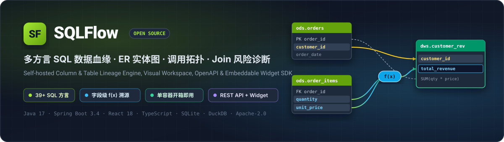
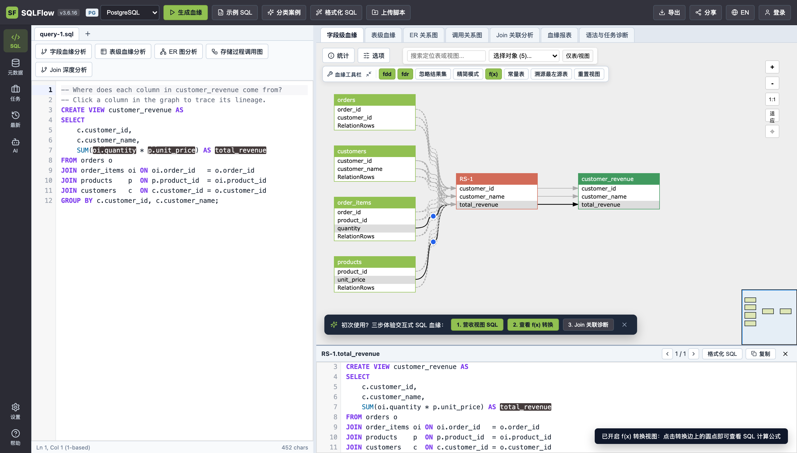
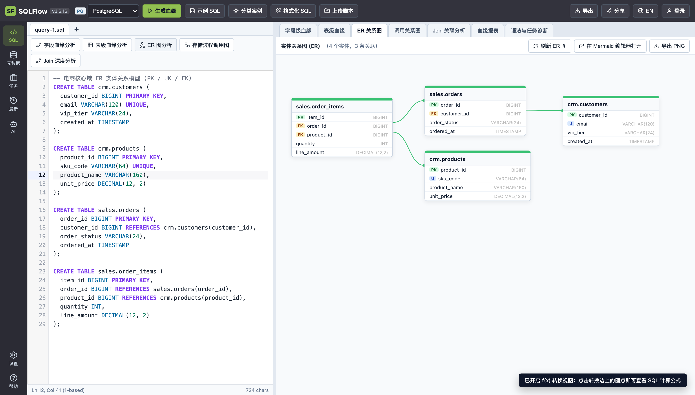
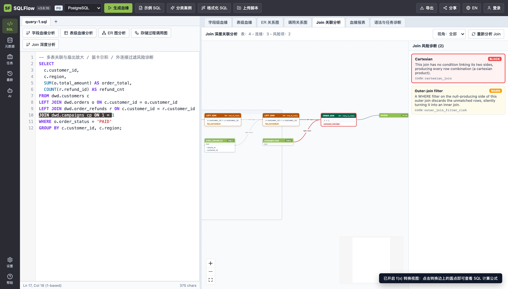
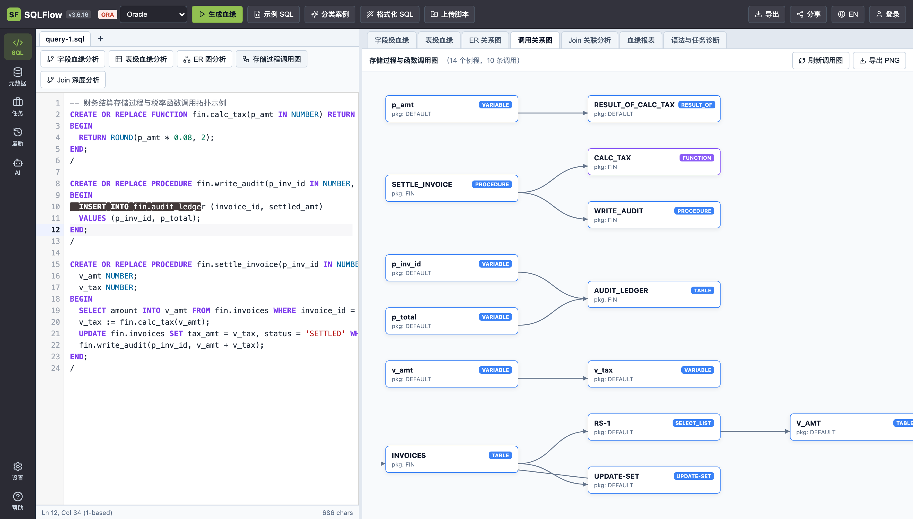
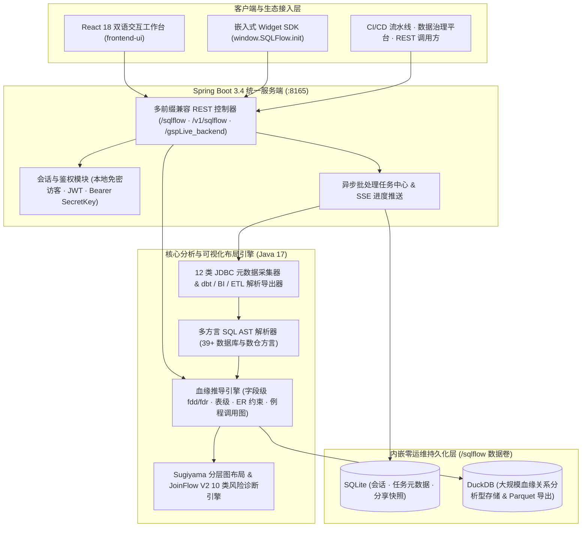

<p align="center">
  
</p>

<p align="center">
  <a href="https://github.com/zhoujingkun1989-arch/sql-flow/actions/workflows/ci.yml"></a>
  <a href="./LICENSE"></a>
  
  
  
  
  
  <a href="https://github.com/zhoujingkun1989-arch/sql-flow/stargazers"></a>
</p>

<p align="center">
  <strong>简体中文</strong> · <a href="./README_EN.md">English</a>
</p>

<p align="center">
  <a href="#-为什么选择-sqlflow">为什么选择 SQLFlow</a> •
  <a href="#-核心功能全景">核心功能</a> •
  <a href="#-30-秒快速上手">快速上手</a> •
  <a href="#-系统架构">系统架构</a> •
  <a href="#-openapi-与嵌入式-sdk">API 与嵌入式 SDK</a> •
  <a href="#-支持的-39-sql-方言矩阵">39+ 方言矩阵</a> •
  <a href="#-本地源码构建与测试">源码构建</a>
</p>

<p align="center">
  <strong>单容器自托管的企业级多方言 SQL 字段级血缘、ER 实体关系图、存储过程调用拓扑与 Join 风险诊断引擎。</strong><br/>
  零外部中间件依赖，单端口（<code>:8165</code>）一体化提供中英双语交互工作台、RESTful OpenAPI 与可嵌入前端的 <code>SQLFlow.init(...)</code> Widget SDK。
</p>

<p align="center">
  
</p>

---

## 💡 为什么选择 SQLFlow？

在数据仓库研发、模型重构、口径溯源与变更影响评估中，团队往往面临两难选择：要么部署维护一套依赖 **Kafka + Elasticsearch + Neo4j** 的重量级元数据平台，要么只能依赖仅输出纯文本的单方言 CLI 解析脚本。

**SQLFlow** 旨在填补这一空白——以 **单个轻量容器** 提供开箱即用的深度 SQL 语法解析、可视化溯源与开放二次集成能力：

| 对比维度 | **SQLFlow** | 传统重型元数据平台 | 单脚本 SQL 解析库 |
| :--- | :--- | :--- | :--- |
| **部署与运维成本** | **单容器一键启动**（内嵌 SQLite + DuckDB，零外部依赖） | 需维护多组件分布式集群，资源开销高 | 仅提供代码库或 CLI，无服务端与界面 |
| **数据血缘精度** | **字段级直接流（`fdd`）+ 间接条件流（`fdr`）+ `f(x)` 算子公式** | 多以表级或粗粒度字段级为主 | 多仅提取表名或简单列映射，无表达式级坐标 |
| **源码双向联动** | **1-based `[行, 列]` 源码编辑器与画布节点/连线双向点击高亮** | 通常仅静态展示图谱，无源码级精准定位 | 无可视化画布 |
| **多维架构视图** | **字段/表级血缘 + ER 实体图 + 存储过程调用图 + Join 风险诊断** | 侧重资产目录检索，缺乏实时 SQL 诊断 | 仅输出单一语法树或邻接表 |
| **SQL 方言覆盖** | **39+ 主流数仓、湖仓、关系型与国产信创方言全解锁** | 依赖采集插件覆盖范围 | 面对复杂方言特性易解析失败 |
| **二次开发集成** | **标准 RESTful OpenAPI + 10 行代码嵌入 `SQLFlow.init` SDK** | 封闭门户为主，前端嵌入改造重 | 需从零自行研发图布局算法与前端画布 |

---

## ✨ 核心功能全景

<table>
  <tr>
    <td width="50%" valign="top">
      <h3 align="center">🔍 字段级血缘与 <code>f(x)</code> 转换溯源</h3>
      <p align="center">
        
      </p>
      <ul>
        <li>精准区分 <code>SELECT</code> / <code>INSERT</code> <strong>直接数据流（<code>fdd</code>）</strong> 与 <code>JOIN</code> / <code>WHERE</code> / <code>GROUP BY</code> <strong>间接影响流（<code>fdr</code>）</strong>。</li>
        <li>可视化展示 <code>f(x)</code> 聚合与转换表达式，点击任意字段或连线即可联动高亮 SQL 源码对应行列区间。</li>
        <li>内置 17 项右键分析菜单：上下游逐跳切片、溯源最左物理源表、忽略中间结果集（<code>RS-*</code>）及 <code>&gt;200</code> 节点大图保护。</li>
      </ul>
    </td>
    <td width="50%" valign="top">
      <h3 align="center">📐 自动化 ER 实体关系图</h3>
      <p align="center">
        
      </p>
      <ul>
        <li>从 DDL 脚本自动提取库表结构、字段数据类型以及 <strong>主键（<code>PK</code>）、唯一键（<code>U</code>）、外键（<code>FK</code>）</strong> 约束徽标。</li>
        <li>基于 Sugiyama 分层泳道自动排布实体卡片与贝塞尔引用关系线，告别手工拖拽排版。</li>
        <li>支持一键生成 <strong>Mermaid ER 代码</strong> 并在 Mermaid Live Editor 打开，或直接导出高清视网膜 PNG。</li>
      </ul>
    </td>
  </tr>
  <tr>
    <td width="50%" valign="top">
      <h3 align="center">🛡️ JoinFlow V2 关联风险深度诊断</h3>
      <p align="center">
        
      </p>
      <ul>
        <li>内置 <strong>10 类 SQL 关联反模式规则</strong>：笛卡尔积（<code>BLOCK</code>）、扇出膨胀放大、外连接 <code>WHERE</code> 过滤退化为内连接（<code>WARN</code>）、隐式类型转换等。</li>
        <li>按角色视角（全部 / 数据工程师 / 数据分析师 / DBA）筛选风险项，点击诊断卡片即刻定位问题算子节点与 SQL 语句行。</li>
        <li>清晰呈现多表连接基数（<code>one_to_many</code> / <code>many_to_many</code>）与连接谓词链路。</li>
      </ul>
    </td>
    <td width="50%" valign="top">
      <h3 align="center">🕸️ 存储过程与函数调用拓扑图</h3>
      <p align="center">
        
      </p>
      <ul>
        <li>深度解析 Oracle PL/SQL、PostgreSQL PL/pgSQL、SQL Server T-SQL、DB2、GaussDB 等过程化脚本。</li>
        <li>自动梳理包（<code>PACKAGE</code>）、存储过程（<code>PROCEDURE</code>）、函数（<code>FUNCTION</code>）、触发器与底表读写之间的多跳调用链路。</li>
        <li>助力老旧核心批处理存储过程重构、影响面盘点与下线拆解。</li>
      </ul>
    </td>
  </tr>
</table>

### 📥 批处理元数据采集 & 📤 全格式开放导出

- **12 类在线 JDBC 库表直连 + 多源 BI/ETL 解析**：支持直连 Oracle、MySQL、PostgreSQL、SQL Server、Azure SQL、Snowflake、Redshift、Greenplum、Teradata、Netezza、Db2、Hive 抓取库表视图元数据；原生支持解析 **`dbt` Manifest**、**Snowflake Query History**、**Tableau**、**PowerBI**、**Informatica**、**SSIS**、**Sqoop** 与 **Erwin** 元数据包，并通过异步任务中心（Job Center）管理大规模血缘构建任务。
- **8 种标准产物导出与快照分享**：支持一键导出结构化 `JSON`、`<dlineage>` `XML`、15 列标准血缘 `CSV`、`GraphML`（兼容 Gephi / yEd）、`Parquet`、高清 `PNG`、离线可交互 `HTML ZIP` 归档包，以及免登录只读分享短链（`/#/p/:id`）。

---

## 🚀 30 秒快速上手

### 方式一：Docker Compose 一键启动（推荐）

```bash
git clone https://github.com/zhoujingkun1989-arch/sql-flow.git
cd sql-flow
docker compose up -d --build
```

### 方式二：Docker 单命令构建与运行

```bash
docker build -f deploy/Dockerfile -t sqlflow:latest .
docker run -d \
  --name sqlflow \
  -p 8165:8165 \
  -v sqlflow_data:/sqlflow \
  sqlflow:latest
```

容器启动后即可直接在浏览器或终端访问：

| 入口名称 | 访问地址 | 说明 |
| :--- | :--- | :--- |
| **Web 交互工作台** | `http://localhost:8165/` | 完整双语 SQL 血缘、ER 图、调用图与 Join 诊断工作台（右上角一键切换 **中文 / EN**） |
| **嵌入式 SDK 示例集** | `http://localhost:8165/widget/1/index.html` | 内置 `1` ~ `16` 共 16 个开箱即用的前端集成交互示例 |
| **服务健康与版本探针** | `http://localhost:8165/version` | 返回引擎版本号与运行状态，便于 K8s / 容器探针接入 |

---

## 🏗️ 系统架构



### 仓库模块导航

| 模块目录 | 技术栈 | 核心职责 |
| :--- | :--- | :--- |
| `contracts/` | Java 17 | 共享领域模型、39+ 方言枚举、JSON/XML 序列化契约与 7 个 `ServiceLoader` SPI 接口 |
| `lineage-engine/` | Java 17 | 多方言 SQL 词法/语法 AST 解析、字段级/表级血缘推导、ER 约束提取与过程调用分析 |
| `graph-layout/` | Java 17 | Sugiyama 有向分层自动布局、JoinFlow V2 关联风险规则引擎、GraphML 与服务端 PNG 渲染 |
| `metadata-connectors/` | Java 17 | JDBC 在线元数据采集器、`dbt`/Tableau/PowerBI/Informatica 解析器及 CSV/ZIP 导出器 |
| `backend-service/` | Spring Boot 3.4 | 单端口（`:8165`）统一 Web 与 OpenAPI 网关、鉴权管理、SQLite + DuckDB 嵌入式存储 |
| `ui-core/` | TypeScript · React | `@sqlflow/ui-core` — 共享类型契约、39 方言目录、三次贝塞尔几何引擎与 `<LineageCanvas />` |
| `frontend-ui/` | React 18 · Vite | `@sqlflow/frontend-ui` — 中英双语 Web 交互工作台、源码高亮联动编辑器与多维分析视图 |
| `widget-sdk/` | TypeScript · UMD/ESM | `@sqlflow/widget-sdk` — 第三方系统零侵入嵌入式组件 SDK（`window.SQLFlow`）及 16 组示例 |
| `deploy/` | Docker · Playwright | 多阶段构建 `Dockerfile`、容器运维脚本（`bin/*.sh`）与 52 项 Playwright 端到端测试套件 |

---

## 🔌 OpenAPI 与嵌入式 SDK

服务端原生支持 `application/json`、表单参数与 `multipart/form-data` 文件上传，可无缝接入数据治理门户、SQL 审核流水线（CI/CD）或内部开发平台。

### 1. 直接调用 REST API 解析 SQL 血缘

```bash
# 传入 SQL 文本，返回包含库表字段节点 (dbobjs)、连线关系 (relationships) 与行列坐标的结构化 JSON
curl -X POST http://localhost:8165/sqlflow/generation/sqlflow \
  -H "Content-Type: application/json" \
  -d '{
    "dbvendor": "dbvpostgresql",
    "sqltext": "CREATE VIEW dws.customer_rev AS SELECT c.customer_id, SUM(oi.quantity * p.unit_price) AS total_rev FROM ods.orders o JOIN ods.order_items oi ON oi.order_id = o.order_id JOIN ods.products p ON p.product_id = oi.product_id JOIN ods.customers c ON c.customer_id = o.customer_id GROUP BY c.customer_id;",
    "showRelationType": "fdd,fdr",
    "ignoreRecordSet": false,
    "showTransform": true
  }'

# 直接上传单个 .sql 或批量 .zip 脚本归档进行解析
curl -X POST http://localhost:8165/sqlflow/generation/sqlflow \
  -F "dbvendor=dbvoracle" \
  -F "showTransform=true" \
  -F "sqlfiles=@./etl_batch.sql"
```

#### 常用核心端点速查

| 接口路径 | 方法 | 功能说明 |
| :--- | :---: | :--- |
| `/sqlflow/generation/sqlflow` | `POST` | 解析 SQL 并返回完整字段级血缘模型（`dataflow`） |
| `/sqlflow/generation/sqlflow/graph` | `POST` | 返回含 Sugiyama 自动布局坐标的交互图谱 JSON |
| `/sqlflow/generation/sqlflow/graph/table_level_lineage` | `POST` | 生成精简表级血缘图谱 |
| `/sqlflow/generation/sqlflow/erdiagramSelectGraph` | `POST` | 提取 `PK` / `UK` / `FK` 约束并生成 ER 实体关系图数据 |
| `/sqlflow/generation/sqlflow/graph/call_lineage` | `POST` | 解析存储过程、函数与包调用拓扑图 |
| `/api/sqlflow/join-analysis` | `POST` | 执行 JoinFlow V2 深度关联与 10 类反模式风险诊断 |
| `/sqlflow/generation/sqlflow/exportLineageAsCsv` | `POST` | 导出 15 列标准字段血缘清单 CSV |
| `/sqlflow/generation/sqlflow/png` | `POST` | 服务端无头渲染并直接返回高清血缘 PNG 图片 |

<details>
<summary><strong>🔐 查看企业级 <code>/v1/sqlflow/**</code> Bearer SecretKey 鉴权调用示例</strong></summary>

```bash
# 1. 生成持久化 API SecretKey
SECRET_KEY=$(curl -s -X POST http://localhost:8165/user/generateSecretKey \
  -H "Content-Type: application/json" -d '{}' | jq -r '.secretKey')

# 2. 携带 Authorization: Bearer <SecretKey> 调用标准 /v1/sqlflow 接口
curl -X POST http://localhost:8165/v1/sqlflow/sqlflow \
  -H "Authorization: Bearer ${SECRET_KEY}" \
  -H "Content-Type: application/json" \
  -d '{
    "dbvendor": "dbvsnowflake",
    "sqltext": "INSERT INTO mart.daily_kpi SELECT dt, COUNT(DISTINCT user_id) FROM dwd.events GROUP BY dt;"
  }'
```

</details>

### 2. 10 行代码将交互式血缘画布嵌入你的前端系统

无需使用笨重的 `<iframe>`，直接引入 `widget-sdk` 即可在自有数据资产门户、Web SQL IDE 或 BI 平台中挂载原生级血缘画布并监听字段点击事件：

```html
<link rel="stylesheet" href="http://localhost:8165/widget/sqlflow.widget.3.6.16.css" />
<script src="http://localhost:8165/widget/sqlflow.widget.3.6.16.js"></script>

<div id="lineage-container" style="width: 100%; height: 620px;"></div>
<script>
  (async () => {
    const sqlflow = await window.SQLFlow.init({
      container: document.getElementById("lineage-container"),
      width: "100%",
      height: 620,
      apiPrefix: "http://localhost:8165/gspLive_backend",
      component: true
    });

    await sqlflow.visualizeSQL(
      "SELECT c.id, SUM(o.amount) AS total_spend FROM crm.customers c JOIN sales.orders o ON c.id = o.customer_id GROUP BY c.id;",
      "postgresql"
    );

    sqlflow.addEventListener("onFieldClick", (field) => {
      console.log("选中血缘字段：", field);
    });
  })();
</script>
```

---

## 🗄️ 支持的 39+ SQL 方言矩阵

SQLFlow 开箱解锁全部 **39 种** SQL 与多维分析查询方言，调用 REST API 时传入下表对应的 `dbvendor` 参数即可：

<details>
<summary><strong>📋 点击展开完整 39 种方言与 <code>dbvendor</code> 参数对照表</strong></summary>

| 分类 | 数据库 / 计算引擎 | `dbvendor` 参数值 | 在线 JDBC 采集 |
| :--- | :--- | :--- | :---: |
| **常用核心方言** | Oracle | `dbvoracle` | ✅ |
| | MySQL | `dbvmysql` | ✅ |
| | PostgreSQL | `dbvpostgresql` | ✅ |
| | Microsoft SQL Server | `dbvmssql` | ✅ |
| | Snowflake | `dbvsnowflake` | ✅ |
| | Google BigQuery | `dbvbigquery` | — |
| **云数仓与 OLAP 湖仓** | ClickHouse | `dbvclickhouse` | — |
| | StarRocks | `dbvstarrocks` | — |
| | Apache Doris | `dbvdoris` | — |
| | DuckDB | `dbvduckdb` | — |
| | Databricks | `dbvdatabricks` | — |
| | Amazon Redshift | `dbvredshift` | ✅ |
| | Amazon Athena | `dbvathena` | — |
| | Azure SQL | `dbvazuresql` | ✅ |
| | Greenplum | `dbvgreenplum` | ✅ |
| | Vertica | `dbvvertica` | — |
| | Teradata | `dbvteradata` | ✅ |
| | IBM Netezza | `dbvnetezza` | ✅ |
| **大数据计算引擎** | Apache Spark SQL | `dbvsparksql` | — |
| | Apache Flink SQL | `dbvflink` | — |
| | Apache Hive | `dbvhive` | ✅ |
| | Apache Impala | `dbvimpala` | — |
| | Trino | `dbvtrino` | — |
| | Presto | `dbvpresto` | — |
| **国产信创数据库** | 华为 GaussDB / openGauss | `dbvgaussdb` | — |
| | OceanBase | `dbvoceanbase` | — |
| | 达梦数据库（Dameng） | `dbvdameng` | — |
| **企业级关系型与专用查询** | IBM Db2 | `dbvdb2` | ✅ |
| | SAP HANA | `dbvhana` | — |
| | EnterpriseDB (EDB) | `dbvedb` | — |
| | Informix | `dbvinformix` | — |
| | Sybase | `dbvsybase` | — |
| | SQLite | `dbvsqlite` | — |
| | Couchbase (N1QL) | `dbvcouchbase` | — |
| | Progress OpenEdge | `dbvopenedge` | — |
| | MDX (OLAP 多维表达式) | `dbvmdx` | — |
| | PowerQuery (M / DAX) | `dbvpowerquery` | — |
| | Salesforce SOQL | `dbvsoql` | — |
| | Generic ODBC SQL | `dbvodbc` | — |

</details>

---

## 🛠️ 本地源码构建与测试

<details>
<summary><strong>💻 点击展开本地编译、直接启动与全量自动化测试指南</strong></summary>

### 1. 环境要求
- **JDK**：`17` 及以上
- **Maven**：`3.9+`
- **Node.js**：`20+`（推荐 `22 LTS`）与 **pnpm** `10.x`（可通过 `corepack enable` 启用）

### 2. 全栈编译打包

```bash
# 1) 安装前端工作区依赖并构建 ui-core、frontend-ui 与 widget-sdk
pnpm install --frozen-lockfile
pnpm -r --if-present build

# 2) 编译并打包全部 5 个 Java 模块
mvn test package
```

### 3. 本地免容器直接运行

```bash
STAGE_DIR=/tmp/sqlflow-runtime
mkdir -p "$STAGE_DIR"/{bin,conf,conf.defaults,lib,static,widget,data,log,tmp}

cp backend-service/target/backend-service-8.2.2.15.jar "$STAGE_DIR/lib/sqlflow-server.jar"
cp -R frontend-ui/dist/. "$STAGE_DIR/static/"
cp -R widget-sdk/dist/. "$STAGE_DIR/widget/"
cp -R deploy/conf/. "$STAGE_DIR/conf/"
cp -R deploy/conf/. "$STAGE_DIR/conf.defaults/"
cp -R deploy/bin/. "$STAGE_DIR/bin/"
cp deploy/docker-entrypoint.sh "$STAGE_DIR/docker-entrypoint.sh"
chmod +x "$STAGE_DIR/docker-entrypoint.sh" "$STAGE_DIR/bin/"*.sh

SQLFLOW_HOME="$STAGE_DIR" "$STAGE_DIR/docker-entrypoint.sh"
```

### 4. 运行自动化测试套件

```bash
# Java 5 模块单元测试
mvn test

# TypeScript 全工作区严格类型检查
pnpm -r --if-present typecheck

# 前端核心库、工作台与 Widget SDK 单元测试 (Vitest)
pnpm --filter @sqlflow/ui-core test
pnpm --filter @sqlflow/frontend-ui test
pnpm --filter @sqlflow/widget-sdk test

# Playwright 端到端集成测试（需先在 :8165 启动服务）
SQLFLOW_BASE_URL=http://localhost:8165 pnpm --filter @sqlflow/e2e test
```

</details>

---

## 🤝 参与贡献

欢迎提交 Issue、Feature Request 或 Pull Request 共建 SQLFlow！

1. Fork 本仓库并新建特性分支：`git checkout -b feat/your-feature`
2. 完成代码修改并确保前后端单元测试通过（`mvn test` & `pnpm -r --if-present test`）
3. 提交清晰的 Commit 说明并发起 Pull Request

如果这个项目对你的数据仓库研发、血缘治理或 SQL 审计工作有帮助，欢迎点亮右上角的 **Star ⭐** 支持我们！

---

## 📈 Star History

<p align="center">
  <a href="https://star-history.com/#zhoujingkun1989-arch/sql-flow&Date">
    <picture>
      <source media="(prefers-color-scheme: dark)" srcset="https://api.star-history.com/svg?repos=zhoujingkun1989-arch/sql-flow&type=Date&theme=dark" />
      <source media="(prefers-color-scheme: light)" srcset="https://api.star-history.com/svg?repos=zhoujingkun1989-arch/sql-flow&type=Date" />
      
    </picture>
  </a>
</p>

---

## 📄 开源协议

本项目基于 [Apache License 2.0](./LICENSE) 开源协议发布。
