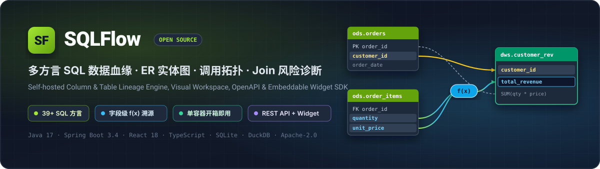
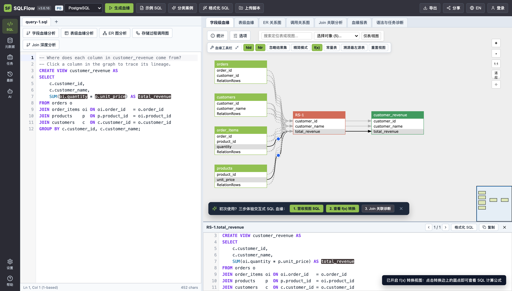
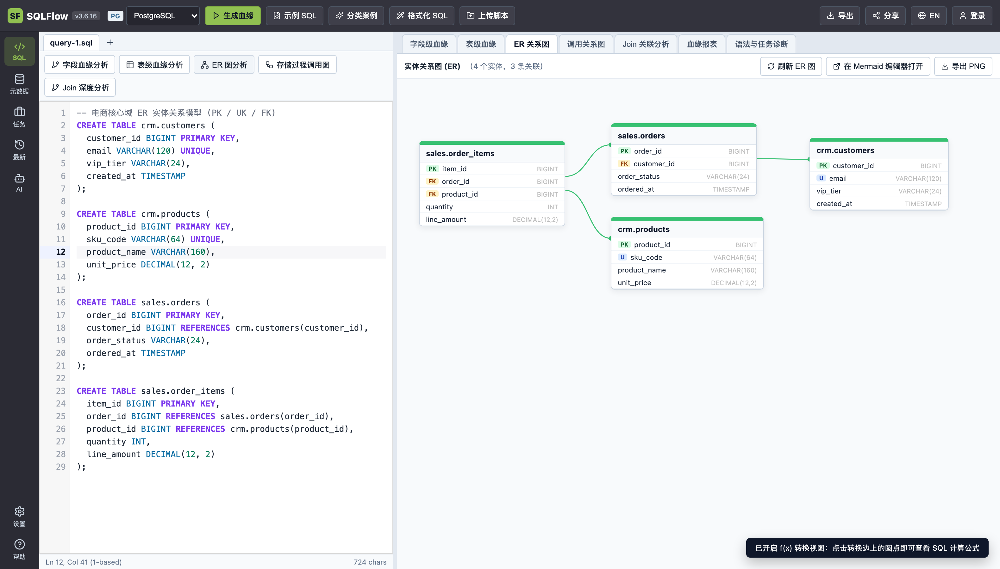
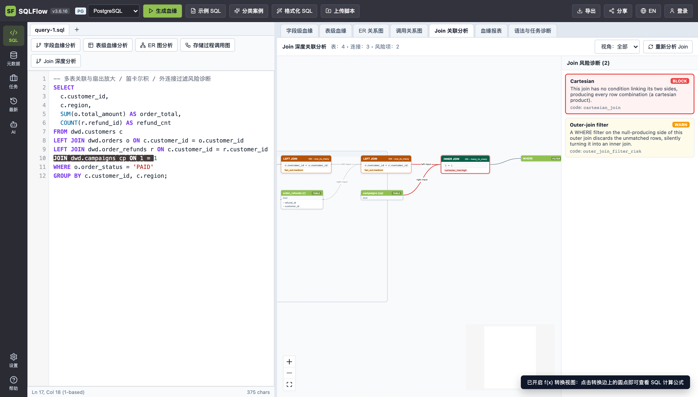
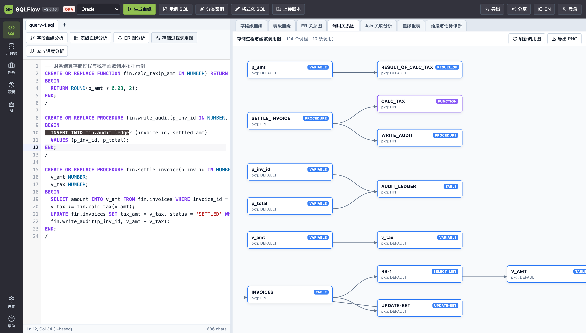
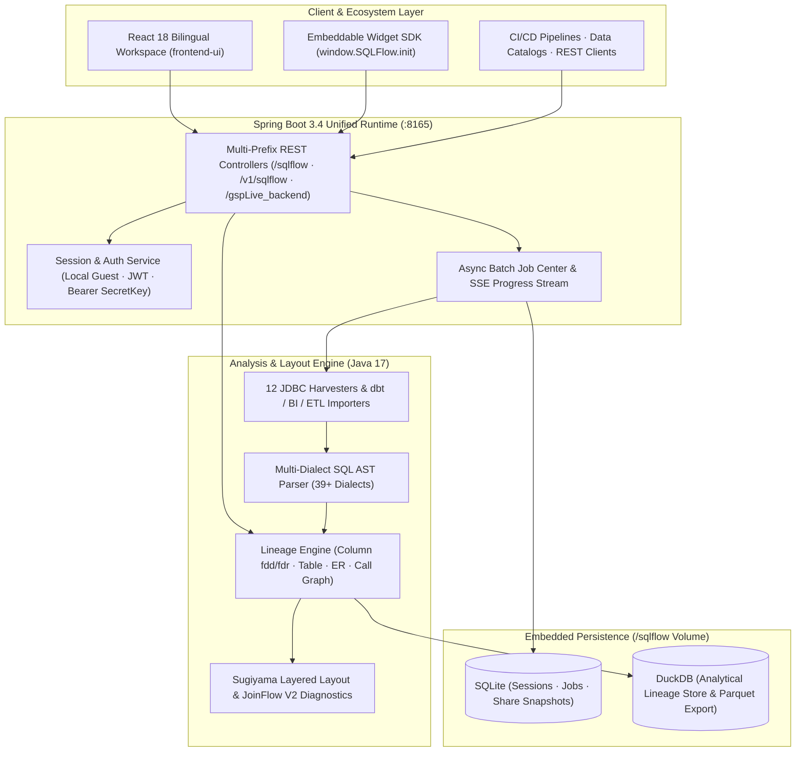

<p align="center">
  
</p>

<p align="center">
  <a href="https://github.com/zhoujingkun1989-arch/sql-flow/actions/workflows/ci.yml"></a>
  <a href="./LICENSE"></a>
  
  
  
  
  
  <a href="https://github.com/zhoujingkun1989-arch/sql-flow/stargazers"></a>
</p>

<p align="center">
  <a href="./README.md">简体中文</a> · <strong>English</strong>
</p>

<p align="center">
  <a href="#-why-sqlflow">Why SQLFlow</a> •
  <a href="#-visual-feature-showcase">Features</a> •
  <a href="#-30-second-quick-start">Quick Start</a> •
  <a href="#-system-architecture">Architecture</a> •
  <a href="#-openapi--embeddable-widget-sdk">API &amp; SDK</a> •
  <a href="#-39-supported-sql-dialects">39+ Dialects</a> •
  <a href="#-build-from-source--testing">Build &amp; Test</a>
</p>

<p align="center">
  <strong>Self-hosted, single-container SQL Column Lineage, ER Diagram, Routine Call Graph, and Join Risk Diagnostics Platform.</strong><br/>
  Zero external infrastructure required — serves a bilingual (English / 中文) React 18 workspace, RESTful OpenAPI, and an embeddable <code>SQLFlow.init(...)</code> Widget SDK from port <code>:8165</code>.
</p>

<p align="center">
  
</p>

---

## 💡 Why SQLFlow?

Data engineering and governance teams typically face two extremes: operating heavyweight metadata clusters backed by **Kafka + Elasticsearch + Neo4j**, or cobbling together CLI parser scripts with no visual exploration or SQL expression coordinates.

**SQLFlow** bridges the gap — delivering compiler-grade multi-dialect SQL analysis, interactive visualization, and developer-friendly APIs in **a single lightweight container**:

| Capability | **SQLFlow** | Heavyweight Metadata Suites | Standalone CLI Parsers |
| :--- | :--- | :--- | :--- |
| **Deployment Footprint** | **Single Docker container** (embedded SQLite + DuckDB, zero external brokers) | Multi-node distributed cluster | Library/CLI only, no UI or server |
| **Lineage Granularity** | **Column-level direct (`fdd`) + indirect clause (`fdr`) + `f(x)` expressions** | Mostly table-level or coarse column edges | Basic column pairs without expression spans |
| **Code Synchronization** | **1-based `[line, col]` bidirectional click highlighting between SQL & graph** | Static graph view only | None |
| **Architectural Views** | **Column/Table Lineage + ER Diagrams + Call Graphs + Join Risk Diagnostics** | Catalog-centric only | Raw AST / JSON output |
| **Dialect Coverage** | **39+ cloud warehouse, lakehouse, RDBMS, and enterprise dialects unlocked** | Connector-dependent | Breaks on dialect-specific syntax |
| **Developer Integration** | **RESTful OpenAPI + 10-line `window.SQLFlow.init` Embeddable Widget SDK** | Monolithic portal | Build your own layout & canvas from scratch |

---

## ✨ Visual Feature Showcase

<table>
  <tr>
    <td width="50%" valign="top">
      <h3 align="center">🔍 Column Lineage &amp; <code>f(x)</code> Expression Tracing</h3>
      <p align="center">
        
      </p>
      <ul>
        <li>Distinguishes <strong>direct dataflow (<code>fdd</code>)</strong> from <code>JOIN</code> / <code>WHERE</code> / <code>GROUP BY</code> <strong>indirect impact edges (<code>fdr</code>)</strong>.</li>
        <li>Inspects inline <code>f(x)</code> SQL expressions and highlights exact 1-based <code>[line, col]</code> spans in the editor on click.</li>
        <li>17-action context menu for hop-by-hop upstream/downstream slicing, leftmost physical table tracing, and <code>&gt;200</code>-node graph protection.</li>
      </ul>
    </td>
    <td width="50%" valign="top">
      <h3 align="center">📐 Automated ER Diagrams</h3>
      <p align="center">
        
      </p>
      <ul>
        <li>Extracts entities, column types, and <strong><code>PK</code> / <code>U</code> / <code>FK</code> constraint badges</strong> directly from DDL scripts.</li>
        <li>Collision-free Sugiyama lane layout with cubic Bézier foreign-key relationship curves.</li>
        <li>One-click export to <strong>Mermaid Live Editor</strong> or high-DPI Retina PNG.</li>
      </ul>
    </td>
  </tr>
  <tr>
    <td width="50%" valign="top">
      <h3 align="center">🛡️ JoinFlow V2 Risk Diagnostics</h3>
      <p align="center">
        
      </p>
      <ul>
        <li>Detects <strong>10 SQL join anti-patterns</strong>: accidental Cartesian products (<code>BLOCK</code>), fan-out amplification, outer-to-inner join filter degradation (<code>WARN</code>), implicit casts, and more.</li>
        <li>Role-based filtering (All / Data Engineer / Analyst / DBA) with instant click-to-highlight on both the join operator node and SQL predicate.</li>
        <li>Visualizes join cardinalities (<code>one_to_many</code>, <code>many_to_many</code>) across complex multi-table queries.</li>
      </ul>
    </td>
    <td width="50%" valign="top">
      <h3 align="center">🕸️ Stored Routine Call Graphs</h3>
      <p align="center">
        
      </p>
      <ul>
        <li>Parses procedural SQL across Oracle PL/SQL, PostgreSQL PL/pgSQL, SQL Server T-SQL, Db2, and GaussDB.</li>
        <li>Maps multi-hop dependencies across packages, stored procedures, functions, triggers, and target tables.</li>
        <li>Accelerates legacy warehouse migration, impact analysis, and stored procedure refactoring.</li>
      </ul>
    </td>
  </tr>
</table>

### 📥 Batch Metadata Harvesters & 📤 Open Exports

- **12 Live JDBC Connectors + BI/ETL Parsers**: Connect directly to Oracle, MySQL, PostgreSQL, SQL Server, Azure SQL, Snowflake, Redshift, Greenplum, Teradata, Netezza, Db2, and Hive — or ingest **`dbt` Manifests**, **Snowflake Query History**, **Tableau**, **PowerBI**, **Informatica**, **SSIS**, **Sqoop**, and **Erwin** packages via the async **Job Center**.
- **8 Export Formats & Read-Only Permalinks**: Export structured `JSON`, `<dlineage>` `XML`, 15-column `CSV`, `GraphML`, `Parquet`, high-DPI `PNG`, standalone interactive `HTML ZIP` bundles, or shareable `/#/p/:id` snapshots.

---

## 🚀 30-Second Quick Start

### Option 1: Docker Compose (Recommended)

```bash
git clone https://github.com/zhoujingkun1989-arch/sql-flow.git
cd sql-flow
docker compose up -d --build
```

### Option 2: Standalone Docker Run

```bash
docker build -f deploy/Dockerfile -t sqlflow:latest .
docker run -d \
  --name sqlflow \
  -p 8165:8165 \
  -v sqlflow_data:/sqlflow \
  sqlflow:latest
```

Once started, open in your browser:

| Entrypoint | URL | Description |
| :--- | :--- | :--- |
| **Interactive Web Workspace** | `http://localhost:8165/` | Full bilingual SQL Lineage, ER, Call Graph, and Join Diagnostics UI (toggle **EN / 中文** in the top-right header) |
| **Embeddable Widget Demos** | `http://localhost:8165/widget/1/index.html` | 16 live interactive Widget SDK integration examples (`1` through `16`) |
| **Health & Version Probe** | `http://localhost:8165/version` | Lightweight JSON readiness endpoint for container orchestrators |

---

## 🏗️ System Architecture



### Repository Modules

| Directory | Stack | Responsibility |
| :--- | :--- | :--- |
| `contracts/` | Java 17 | Domain schemas, 39+ dialect enums, XML/JSON models, and 7 `ServiceLoader` SPI contracts |
| `lineage-engine/` | Java 17 | Multi-dialect SQL AST parser and column/table/ER/routine lineage analyzer |
| `graph-layout/` | Java 17 | Sugiyama layered graph layout, JoinFlow V2 10-rule diagnostics, GraphML & PNG renderers |
| `metadata-connectors/` | Java 17 | Live JDBC harvesters, `dbt`/Tableau/PowerBI/Informatica parsers, and CSV/ZIP exporters |
| `backend-service/` | Spring Boot 3.4 | Unified HTTP server (`:8165`), authentication, SSE job streaming, SQLite + DuckDB storage |
| `ui-core/` | TypeScript · React | `@sqlflow/ui-core` — shared types, 39-dialect catalog, cubic Bézier math, `<LineageCanvas />` |
| `frontend-ui/` | React 18 · Vite | `@sqlflow/frontend-ui` — bilingual interactive Web SPA and multi-tab analysis views |
| `widget-sdk/` | TypeScript · UMD/ESM | `@sqlflow/widget-sdk` — `window.SQLFlow` embeddable component SDK and 16 live demos |
| `deploy/` | Docker · Playwright | Multi-stage `Dockerfile`, operational shell scripts, and 52 Playwright E2E tests |

---

## 🔌 OpenAPI & Embeddable Widget SDK

### 1. Query the REST API Directly

```bash
# Parse SQL text into structured column-level lineage JSON (dbobjs + relationships + coordinates)
curl -X POST http://localhost:8165/sqlflow/generation/sqlflow \
  -H "Content-Type: application/json" \
  -d '{
    "dbvendor": "dbvpostgresql",
    "sqltext": "CREATE VIEW dws.customer_rev AS SELECT c.customer_id, SUM(oi.quantity * p.unit_price) AS total_rev FROM ods.orders o JOIN ods.order_items oi ON oi.order_id = o.order_id JOIN ods.products p ON p.product_id = oi.product_id JOIN ods.customers c ON c.customer_id = o.customer_id GROUP BY c.customer_id;",
    "showRelationType": "fdd,fdr",
    "ignoreRecordSet": false,
    "showTransform": true
  }'

# Upload a .sql file or batch .zip archive via multipart/form-data
curl -X POST http://localhost:8165/sqlflow/generation/sqlflow \
  -F "dbvendor=dbvoracle" \
  -F "showTransform=true" \
  -F "sqlfiles=@./etl_batch.sql"
```

#### Core Endpoints Cheat Sheet

| Endpoint | Method | Description |
| :--- | :---: | :--- |
| `/sqlflow/generation/sqlflow` | `POST` | Parse SQL and return full column-level lineage (`dataflow`) |
| `/sqlflow/generation/sqlflow/graph` | `POST` | Return lineage graph JSON with Sugiyama node layout coordinates |
| `/sqlflow/generation/sqlflow/graph/table_level_lineage` | `POST` | Generate table-level lineage graph |
| `/sqlflow/generation/sqlflow/erdiagramSelectGraph` | `POST` | Extract `PK` / `UK` / `FK` constraints and generate ER diagram graph |
| `/sqlflow/generation/sqlflow/graph/call_lineage` | `POST` | Generate stored procedure & function call graph |
| `/api/sqlflow/join-analysis` | `POST` | Run JoinFlow V2 join graph & 10-rule anti-pattern diagnostics |
| `/sqlflow/generation/sqlflow/exportLineageAsCsv` | `POST` | Export 15-column standard lineage CSV |
| `/sqlflow/generation/sqlflow/png` | `POST` | Render and download server-side lineage PNG |

<details>
<summary><strong>🔐 Enterprise <code>/v1/sqlflow/**</code> Bearer SecretKey Authentication Example</strong></summary>

```bash
# 1. Generate an API SecretKey
SECRET_KEY=$(curl -s -X POST http://localhost:8165/user/generateSecretKey \
  -H "Content-Type: application/json" -d '{}' | jq -r '.secretKey')

# 2. Call /v1/sqlflow endpoints with Authorization: Bearer <SecretKey>
curl -X POST http://localhost:8165/v1/sqlflow/sqlflow \
  -H "Authorization: Bearer ${SECRET_KEY}" \
  -H "Content-Type: application/json" \
  -d '{
    "dbvendor": "dbvsnowflake",
    "sqltext": "INSERT INTO mart.daily_kpi SELECT dt, COUNT(DISTINCT user_id) FROM dwd.events GROUP BY dt;"
  }'
```

</details>

### 2. Embed the Interactive Lineage Canvas in 10 Lines (`SQLFlow.init`)

Mount the interactive lineage canvas natively inside your own data catalog, Web SQL IDE, or BI portal without iframes:

```html
<link rel="stylesheet" href="http://localhost:8165/widget/sqlflow.widget.3.6.16.css" />
<script src="http://localhost:8165/widget/sqlflow.widget.3.6.16.js"></script>

<div id="lineage-container" style="width: 100%; height: 620px;"></div>
<script>
  (async () => {
    const sqlflow = await window.SQLFlow.init({
      container: document.getElementById("lineage-container"),
      width: "100%",
      height: 620,
      apiPrefix: "http://localhost:8165/gspLive_backend",
      component: true
    });

    await sqlflow.visualizeSQL(
      "SELECT c.id, SUM(o.amount) AS total_spend FROM crm.customers c JOIN sales.orders o ON c.id = o.customer_id GROUP BY c.id;",
      "postgresql"
    );

    sqlflow.addEventListener("onFieldClick", (field) => {
      console.log("Selected column:", field);
    });
  })();
</script>
```

---

## 🗄️ 39+ Supported SQL Dialects

All **39 dialects** are unlocked out of the box. Pass the corresponding `dbvendor` value when calling REST APIs:

<details>
<summary><strong>📋 Expand Full 39-Dialect &amp; <code>dbvendor</code> Parameter Matrix</strong></summary>

| Category | Database / Query Engine | `dbvendor` Parameter | Live JDBC Harvester |
| :--- | :--- | :--- | :---: |
| **Popular Core** | Oracle | `dbvoracle` | ✅ |
| | MySQL | `dbvmysql` | ✅ |
| | PostgreSQL | `dbvpostgresql` | ✅ |
| | Microsoft SQL Server | `dbvmssql` | ✅ |
| | Snowflake | `dbvsnowflake` | ✅ |
| | Google BigQuery | `dbvbigquery` | — |
| **Cloud Warehouses & OLAP** | ClickHouse | `dbvclickhouse` | — |
| | StarRocks | `dbvstarrocks` | — |
| | Apache Doris | `dbvdoris` | — |
| | DuckDB | `dbvduckdb` | — |
| | Databricks | `dbvdatabricks` | — |
| | Amazon Redshift | `dbvredshift` | ✅ |
| | Amazon Athena | `dbvathena` | — |
| | Azure SQL | `dbvazuresql` | ✅ |
| | Greenplum | `dbvgreenplum` | ✅ |
| | Vertica | `dbvvertica` | — |
| | Teradata | `dbvteradata` | ✅ |
| | IBM Netezza | `dbvnetezza` | ✅ |
| **Big Data & Lakehouse** | Apache Spark SQL | `dbvsparksql` | — |
| | Apache Flink SQL | `dbvflink` | — |
| | Apache Hive | `dbvhive` | ✅ |
| | Apache Impala | `dbvimpala` | — |
| | Trino | `dbvtrino` | — |
| | Presto | `dbvpresto` | — |
| **Distributed & Enterprise RDBMS** | GaussDB / openGauss | `dbvgaussdb` | — |
| | OceanBase | `dbvoceanbase` | — |
| | Dameng | `dbvdameng` | — |
| | IBM Db2 | `dbvdb2` | ✅ |
| | SAP HANA | `dbvhana` | — |
| | EnterpriseDB (EDB) | `dbvedb` | — |
| | Informix | `dbvinformix` | — |
| | Sybase | `dbvsybase` | — |
| | SQLite | `dbvsqlite` | — |
| | Couchbase (N1QL) | `dbvcouchbase` | — |
| | Progress OpenEdge | `dbvopenedge` | — |
| | MDX | `dbvmdx` | — |
| | PowerQuery (M / DAX) | `dbvpowerquery` | — |
| | Salesforce SOQL | `dbvsoql` | — |
| | Generic ODBC SQL | `dbvodbc` | — |

</details>

---

## 🛠️ Build from Source & Testing

<details>
<summary><strong>💻 Expand Local Build, Bare-Metal Run &amp; Test Suite Commands</strong></summary>

### Prerequisites
- **JDK**: `17+`
- **Maven**: `3.9+`
- **Node.js**: `20+` (`22 LTS` recommended) & **pnpm** `10.x` (`corepack enable`)

### Build All Modules

```bash
# 1) Install frontend workspace dependencies and build ui-core, frontend-ui, and widget-sdk
pnpm install --frozen-lockfile
pnpm -r --if-present build

# 2) Compile and package all 5 Java modules
mvn test package
```

### Run Locally Without Docker

```bash
STAGE_DIR=/tmp/sqlflow-runtime
mkdir -p "$STAGE_DIR"/{bin,conf,conf.defaults,lib,static,widget,data,log,tmp}

cp backend-service/target/backend-service-8.2.2.15.jar "$STAGE_DIR/lib/sqlflow-server.jar"
cp -R frontend-ui/dist/. "$STAGE_DIR/static/"
cp -R widget-sdk/dist/. "$STAGE_DIR/widget/"
cp -R deploy/conf/. "$STAGE_DIR/conf/"
cp -R deploy/conf/. "$STAGE_DIR/conf.defaults/"
cp -R deploy/bin/. "$STAGE_DIR/bin/"
cp deploy/docker-entrypoint.sh "$STAGE_DIR/docker-entrypoint.sh"
chmod +x "$STAGE_DIR/docker-entrypoint.sh" "$STAGE_DIR/bin/"*.sh

SQLFLOW_HOME="$STAGE_DIR" "$STAGE_DIR/docker-entrypoint.sh"
```

### Run Test Suites

```bash
# Java unit tests across all 5 modules
mvn test

# Workspace TypeScript typecheck
pnpm -r --if-present typecheck

# Frontend & Widget SDK unit tests (Vitest)
pnpm --filter @sqlflow/ui-core test
pnpm --filter @sqlflow/frontend-ui test
pnpm --filter @sqlflow/widget-sdk test

# Playwright E2E suite (requires server running on :8165)
SQLFLOW_BASE_URL=http://localhost:8165 pnpm --filter @sqlflow/e2e test
```

</details>

---

## 🤝 Contributing

Contributions, bug reports, and feature requests are welcome!

1. Fork the repository and create a feature branch: `git checkout -b feat/your-feature`
2. Make your changes and verify tests pass (`mvn test` & `pnpm -r --if-present test`)
3. Open a Pull Request with a clear summary of your changes

If SQLFlow helps your data engineering or SQL governance workflow, please consider giving the repository a **Star ⭐**!

---

## 📈 Star History

<p align="center">
  <a href="https://star-history.com/#zhoujingkun1989-arch/sql-flow&Date">
    <picture>
      <source media="(prefers-color-scheme: dark)" srcset="https://api.star-history.com/svg?repos=zhoujingkun1989-arch/sql-flow&type=Date&theme=dark" />
      <source media="(prefers-color-scheme: light)" srcset="https://api.star-history.com/svg?repos=zhoujingkun1989-arch/sql-flow&type=Date" />
      
    </picture>
  </a>
</p>

---

## 📄 License

Licensed under the [Apache License, Version 2.0](./LICENSE).
